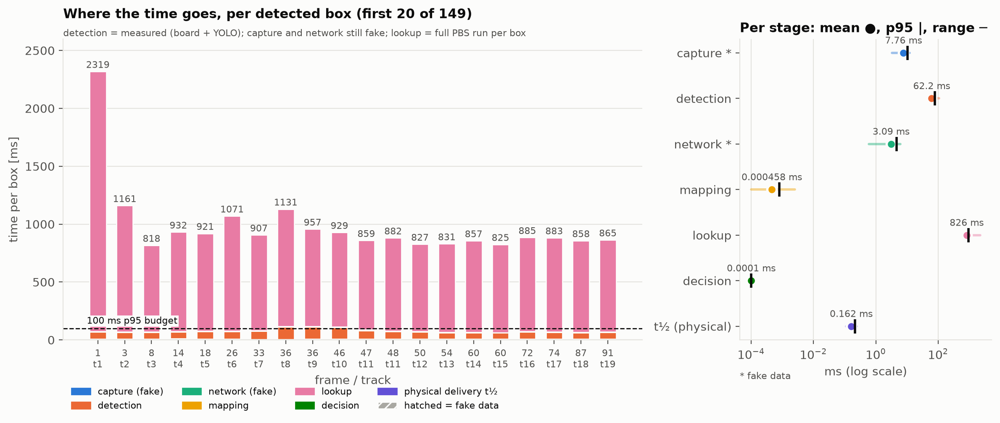
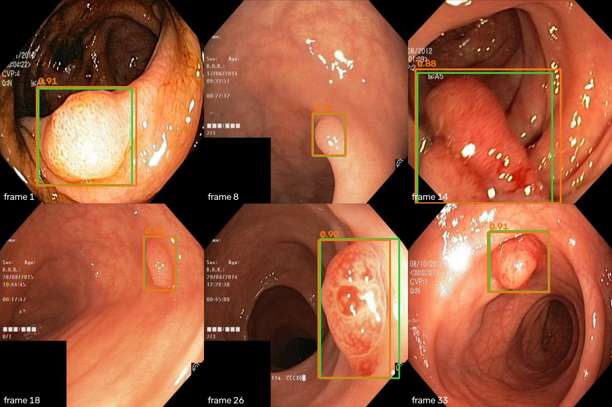

# Detection results

All numbers on the held-out test split shared by both models (`Data/splits.json`); no test image, and no copy of one, is used for training. Generated by `report.py` from the JSON/CSV files in this folder.

## Classifier: MobileNetV1 0.25, binary polyp yes/no (board)

Test split: Kvasir-SEG test polyps (+ their Kvasir v1 copies) and test negatives (HyperKvasir lower-GI normals, Kvasir-Capsule normal mucosa, Kvasir v1 ulcerative colitis / dyed resection margins). Threshold picked on val for ≥95 % recall.

| Model | Input | Precision | Recall | F1 | Specificity | ROC-AUC | TN / FP / FN / TP | Threshold |
|---|---|---|---|---|---|---|---|---|
| Float | 96×96 | 0.974 | 0.961 | 0.967 | 0.994 | 0.999 | 644 / 4 / 6 / 147 | logit ≥ 0.50 |
| INT8 | 96×96 | 0.980 | 0.941 | 0.960 | 0.995 | 0.999 | 645 / 3 / 9 / 144 | int8 ≥ 45 |
| Float | 84×84 | 0.967 | 0.967 | 0.967 | 0.992 | 0.999 | 643 / 5 / 5 / 148 | logit ≥ -0.01 |
| INT8 | 84×84 | 0.987 | 0.961 | 0.974 | 0.997 | 0.998 | 646 / 2 / 6 / 147 | int8 ≥ 30 |

| Input | Params | MACs | .tflite | Peak activations | Ops | QAT | PC interpreter (host, 1 thread)* |
|---|---|---|---|---|---|---|---|
| 96×96 | 218,801 | 6.69 M | 297 KB | 54 KB | AVERAGE_POOL_2D, CONV_2D, DEPTHWISE_CONV_2D | no | 0.29 ms |
| 84×84 | 218,801 | 6.16 M | 297 KB | 41 KB | AVERAGE_POOL_2D, CONV_2D, DEPTHWISE_CONV_2D | no | 0.33 ms |

\* TFLite built-in optimised kernels (no XNNPACK) on the PC: a sanity check, **not** board latency. The board must fit the model in 512 KB RAM; peak activations are well inside it.

### Kvasir-Capsule only (domain shift)

Kvasir-Capsule polyp frames (all from one video) + normal-mucosa frames from test videos. Same threshold as above. Never used for training.

| Model | Input | Recall | Specificity | ROC-AUC | TN / FP / FN / TP |
|---|---|---|---|---|---|
| Float | 96×96 | 0.000 | 1.000 | 0.736 | 257 / 0 / 55 / 0 |
| INT8 | 96×96 | 0.000 | 0.996 | 0.660 | 256 / 1 / 55 / 0 |
| Float | 84×84 | 0.000 | 1.000 | 0.801 | 257 / 0 / 55 / 0 |
| INT8 | 84×84 | 0.000 | 1.000 | 0.813 | 257 / 0 / 55 / 0 |

## Classifier on the nRF54LM20 DK (measured on the board)

MobileNetV1 0.25 INT8, 84×84 input (`runs/classifier_84`), compiled with the Axon NN compiler and run on the Axon NPU of the nRF54LM20B; threshold int8 ≥ 30. Frames are sent one at a time from the PC over USB CDC-ACM (high speed); see `Board/README.md` for the protocol and how each time is measured.

### Test set: 801 replay frames (153 polyp, 648 no polyp)

The test split of `Data/splits.json` as 336×336 JPEG frames (`Data/test/frames`, labels in `Data/test/labels.csv`). None of these images, or copies of them, are used for training.

| Source folder | Class | Frames |
|---|---|---|
| `Data/negatives/kvasir-capsule` | no polyp | 257 |
| `Data/negatives/hyperkvasir/cecum` | no polyp | 114 |
| `Data/negatives/hyperkvasir/bbps-2-3` | no polyp | 113 |
| `Data/kvasir/kvasir-dataset/dyed-resection-margins` | no polyp | 58 |
| `Data/negatives/hyperkvasir/bbps-0-1` | no polyp | 53 |
| `Data/kvasir/kvasir-dataset/ulcerative-colitis` | no polyp | 52 |
| `Data/negatives/hyperkvasir/ileum` | no polyp | 1 |
| `Data/kvasir-seg-split/images/test` | polyp | 100 |
| `Data/kvasir/kvasir-dataset/polyps` | polyp | 53 |

`kvasir-dataset/polyps` are the Kvasir v1 copies of the Kvasir-SEG test images (uncropped); `negatives/kvasir-capsule` are Kvasir-Capsule normal-mucosa frames from the test videos.

### Metrics on the board

| Input sent to the board | Frames | Precision | Recall | F1 | Specificity | ROC-AUC (raw int8) | TN / FP / FN / TP | Same decision as the PC INT8 model |
|---|---|---|---|---|---|---|---|---|
| JPEG (FRM0): 336×336 JPEG, decoded on the board at 1/4 scale | 801 | 0.980 | 0.954 | 0.967 | 0.995 | 0.999 | 645 / 3 / 7 / 146 | 800 / 801 |
| raw (RAW0): 84×84 RGB, area-resized on the PC, no decode on the board | 801 | 0.987 | 0.961 | 0.974 | 0.997 | 0.998 | 646 / 2 / 6 / 147 | 800 / 801 |

### Time per frame and in total (board clock for the board stages, host clock for board → PC)

| Input | Stage | p50 ms | p95 ms | mean ms | min ms | max ms | total, all frames |
|---|---|---|---|---|---|---|---|
| JPEG (FRM0) | PC → board (USB, frame payload) | 67.45 | 99.89 | 70.57 | 37.16 | 134.47 | 56.53 s |
| JPEG (FRM0) | board preprocessing | 192.88 | 214.96 | 193.96 | 167.89 | 237.01 | 155.36 s |
| JPEG (FRM0) | **Axon inference** | 14.85 | 14.86 | 14.85 | 14.84 | 14.87 | 11.89 s |
| JPEG (FRM0) | board → PC (result line + frame if detected) | 1.51 | 33.26 | 7.00 | 0.85 | 48.02 | 5.61 s |
| JPEG (FRM0) | **board compute (preprocessing + inference)** | 207.74 | 229.81 | 208.81 | 182.74 | 251.85 | 167.25 s |
| JPEG (FRM0) | **round trip per frame (PC send → reply in)** | 282.96 | 346.74 | 286.38 | 221.65 | 410.88 | 229.39 s |
| raw (RAW0) | PC → board (USB, frame payload) | 69.30 | 72.85 | 69.65 | 67.62 | 85.86 | 55.79 s |
| raw (RAW0) | board preprocessing | 1.11 | 1.11 | 1.11 | 1.11 | 1.11 | 0.89 s |
| raw (RAW0) | **Axon inference** | 14.69 | 14.69 | 14.69 | 14.69 | 14.70 | 11.77 s |
| raw (RAW0) | board → PC (result line + frame if detected) | 1.66 | 27.33 | 6.39 | 0.96 | 53.63 | 5.12 s |
| raw (RAW0) | **board compute (preprocessing + inference)** | 15.80 | 15.81 | 15.80 | 15.80 | 15.81 | 12.66 s |
| raw (RAW0) | **round trip per frame (PC send → reply in)** | 87.00 | 113.29 | 91.84 | 84.83 | 138.12 | 73.57 s |

Per-frame values: `board_jpeg_frames.csv`, `board_raw_frames.csv` (columns described in `Board/receiver.py`). In raw mode the PC's decode + resize to 84×84 is not included; on the pill that work moves to the sender.

## YOLO26n box detector (PC)

`test` = Kvasir-SEG test (100 images) + every test negative as a background image (648), so false positives count. `test_pos` = the 100 polyp images only. mAP at conf 0.001; tightness and false alarms at the deployment confidence (F1-optimal on val).

| Model | Format | Split | Precision | Recall | mAP50 | mAP50-95 |
|---|---|---|---|---|---|---|
| yolo26n | pt | test | 0.902 | 0.888 | 0.919 | 0.722 |
| yolo26n | pt | test_pos | 0.929 | 0.878 | 0.938 | 0.736 |
| yolo26n | onnx | test | 0.917 | 0.885 | 0.930 | 0.732 |
| yolo26n | onnx | test_pos | 0.928 | 0.885 | 0.944 | 0.743 |
| yolo26n | int8 | test | 0.891 | 0.865 | 0.896 | 0.675 |
| yolo26n | int8 | test_pos | 0.886 | 0.893 | 0.919 | 0.691 |
| yolo26n | openvino_fp16 | test | 0.926 | 0.885 | 0.930 | 0.732 |
| yolo26n | openvino_fp16 | test_pos | 0.930 | 0.891 | 0.944 | 0.743 |
| yolo26n_p2 | pt | test | 0.916 | 0.933 | 0.943 | 0.705 |
| yolo26n_p2 | pt | test_pos | 0.941 | 0.933 | 0.953 | 0.713 |
| yolo26n_p2 | onnx | test | 0.933 | 0.942 | 0.943 | 0.691 |
| yolo26n_p2 | onnx | test_pos | 0.960 | 0.942 | 0.956 | 0.701 |
| yolo26n_p2 | int8 | test | 0.917 | 0.904 | 0.927 | 0.683 |
| yolo26n_p2 | int8 | test_pos | 0.940 | 0.911 | 0.939 | 0.689 |
| yolo26n_p2 | openvino_fp16 | test | 0.933 | 0.941 | 0.942 | 0.693 |
| yolo26n_p2 | openvino_fp16 | test_pos | 0.961 | 0.942 | 0.955 | 0.703 |

### Box tightness (test_pos) and false alarms (test backgrounds)

Greedy one-to-one matching at IoU ≥ 0.5. Width/height errors in pixels of the 336×336 frame; signed = predicted minus ground truth (positive = box too large).

| Model | Format | Conf | Matched | Mean IoU | Median IoU | abs W / H err (px) | signed W / H err (px) | Backgrounds with a box |
|---|---|---|---|---|---|---|---|---|
| yolo26n | pt | 0.385 | 95/104 | 0.894 | 0.929 | 8.9 / 8.2 | +0.8 / +0.5 | 7/648 (1.1%) |
| yolo26n | onnx | 0.385 | 95/104 | 0.894 | 0.929 | 8.9 / 8.2 | +0.8 / +0.5 | 7/648 (1.1%) |
| yolo26n | int8 | 0.385 | 94/104 | 0.883 | 0.918 | 9.6 / 8.6 | -0.3 / +1.6 | 5/648 (0.8%) |
| yolo26n | openvino_fp16 | 0.385 | 95/104 | 0.894 | 0.929 | 8.8 / 8.4 | +1.5 / +0.9 | 7/648 (1.1%) |
| yolo26n_p2 | pt | 0.251 | 99/104 | 0.873 | 0.914 | 11.4 / 11.4 | -4.1 / +0.5 | 11/648 (1.7%) |
| yolo26n_p2 | onnx | 0.251 | 99/104 | 0.873 | 0.914 | 11.4 / 11.4 | -4.1 / +0.5 | 11/648 (1.7%) |
| yolo26n_p2 | int8 | 0.251 | 98/104 | 0.871 | 0.911 | 11.1 / 11.4 | -2.2 / +1.2 | 6/648 (0.9%) |
| yolo26n_p2 | openvino_fp16 | 0.251 | 99/104 | 0.873 | 0.917 | 11.3 / 11.3 | -4.1 / +0.4 | 11/648 (1.7%) |

### yolo26n: CPU latency on this PC (measured)

Apple M3, macOS-26.5.1-arm64-arm-64bit; batch 1, 336x336 frames, 20 warm-up + 200 timed frames per row, one model at a time on an idle machine. p50 / p95 in ms.

| Format | Threads | Pre | Infer | Post | **Total** |
|---|---|---|---|---|---|
| onnx_fp32 | 1 | 0.64 / 0.85 | 38.09 / 38.59 | 0.09 / 0.15 | **38.87 / 39.47** |
| onnx_fp32 | 2 | 0.59 / 0.73 | 21.21 / 21.54 | 0.09 / 0.13 | **21.86 / 22.27** |
| onnx_fp32 | 4 | 0.82 / 0.96 | 16.27 / 16.89 | 0.10 / 0.13 | **17.20 / 17.88** |
| onnx_int8 | 1 | 0.40 / 0.58 | 16.82 / 17.25 | 0.06 / 0.12 | **17.30 / 17.93** |
| onnx_int8 | 2 | 0.48 / 0.59 | 10.93 / 11.04 | 0.05 / 0.07 | **11.45 / 11.70** |
| onnx_int8 | 4 | 0.74 / 0.84 | 9.22 / 10.01 | 0.07 / 0.08 | **10.00 / 10.92** |
| openvino_fp16 | 1 | 0.57 / 0.73 | 24.52 / 25.14 | 0.07 / 0.12 | **25.20 / 26.05** |
| openvino_fp16 | 2 | 0.56 / 0.64 | 13.68 / 13.96 | 0.06 / 0.09 | **14.32 / 14.71** |
| openvino_fp16 | 4 | 0.55 / 0.70 | 8.92 / 10.87 | 0.07 / 0.11 | **9.53 / 11.72** |
| openvino_int8 | 1 | 0.47 / 0.74 | 72.04 / 73.64 | 0.14 / 0.21 | **72.63 / 74.34** |
| openvino_int8 | 2 | 0.44 / 0.65 | 37.94 / 38.39 | 0.09 / 0.13 | **38.53 / 39.14** |
| openvino_int8 | 4 | 0.48 / 0.64 | 20.35 / 22.11 | 0.07 / 0.11 | **20.91 / 22.76** |

### yolo26n_p2: CPU latency on this PC (measured)

Apple M3, macOS-26.5.1-arm64-arm-64bit; batch 1, 336x336 frames, 20 warm-up + 200 timed frames per row, one model at a time on an idle machine. p50 / p95 in ms.

| Format | Threads | Pre | Infer | Post | **Total** |
|---|---|---|---|---|---|
| onnx_fp32 | 1 | 0.50 / 0.62 | 50.57 / 51.65 | 0.12 / 0.19 | **51.17 / 52.31** |
| onnx_fp32 | 2 | 0.53 / 0.63 | 27.92 / 28.30 | 0.11 / 0.14 | **28.60 / 28.98** |
| onnx_fp32 | 4 | 0.81 / 0.99 | 21.28 / 21.63 | 0.15 / 0.17 | **22.09 / 22.66** |
| onnx_int8 | 1 | 0.45 / 0.59 | 26.08 / 26.30 | 0.07 / 0.10 | **26.61 / 26.92** |
| onnx_int8 | 2 | 0.47 / 0.59 | 16.71 / 16.94 | 0.07 / 0.09 | **17.24 / 17.57** |
| onnx_int8 | 4 | 0.69 / 0.80 | 14.67 / 15.51 | 0.11 / 0.12 | **15.45 / 16.38** |
| openvino_fp16 | 1 | 0.56 / 0.61 | 35.48 / 35.87 | 0.07 / 0.10 | **36.23 / 36.71** |
| openvino_fp16 | 2 | 0.56 / 0.61 | 19.35 / 19.62 | 0.07 / 0.10 | **19.98 / 20.39** |
| openvino_fp16 | 4 | 0.54 / 0.73 | 12.37 / 14.34 | 0.08 / 0.10 | **13.07 / 15.21** |
| openvino_int8 | 1 | 0.50 / 0.73 | 102.91 / 103.83 | 0.12 / 0.19 | **103.67 / 104.63** |
| openvino_int8 | 2 | 0.42 / 0.62 | 53.45 / 53.82 | 0.08 / 0.12 | **54.02 / 54.53** |
| openvino_int8 | 4 | 0.49 / 0.65 | 28.32 / 32.55 | 0.08 / 0.13 | **28.97 / 33.18** |

## Latency per stage (pipeline run)

| Stage | p50 ms | p95 ms | n | Label | How / where |
|---|---|---|---|---|---|
| 1 · frame → board | 69.30 | 72.85 | 801 | measured | USB CDC-ACM host->board, from Board/receiver.py |
| 2a · board preprocessing | 1.11 | 1.11 | 801 | measured | board timer |
| 2b · board inference | 14.69 | 14.69 | 801 | measured | board cycle counter |
| 3 · board → PC (USB) | 27.24 | 28.41 | 149 | measured | USB CDC-ACM board->host incl. frame bytes, Board/receiver.py |
| 4 · YOLO26n on PC CPU | 17.52 | 29.84 | 149 | measured | best_openvino_model (OpenVINO, FP16 compute on ARM), PC CPU, 4 threads, pre+infer+post |
| &nbsp;&nbsp;4a · pre | 1.03 | 1.44 | 149 | measured |  |
| &nbsp;&nbsp;4b · infer | 16.18 | 28.12 | 149 | measured |  |
| &nbsp;&nbsp;4c · post | 0.16 | 0.38 | 149 | measured |  |
| **Detection total** (2 + 3 + 4) | 60.55 | 76.39 | 143 | measured | t_detect - t_capture per frame with boxes = stage 2 + 3 + 4 (stage 1 not included) |
| 5 · simulation per box | 801.41 | 930.55 | 149 | measured | bbox_replay process_box() wall time (full PBS run per box until the lookup table exists) |

Detection p95 = **76.4 ms** vs the 100 ms target: **within** budget (measured; stage 1 is not included). Counts: {'frames': 801, 'detected': 149, 'frames_with_boxes': 143, 'boxes': 149}.

In the figure, *detection* is the measured value from this run; *capture* and *network* are still the visualizer's fake values (hatched); *lookup* is the full PBS run per box until the lookup table exists.

### End to end (classifier + YOLO26n on the replay frames)

| | |
|---|---|
| Kvasir-SEG polyp frames flagged by the classifier | 99 / 100 |
| Kvasir-SEG polyp frames ending with a correct box (IoU ≥ 0.5) | **91 / 100** |
| All polyp frames ending with any box | 143 / 153 |
| Polyp-free frames flagged by the classifier | 2 / 648 |
| Polyp-free frames ending with a box (false injection) | **0 / 648** |

### Example frames

Green = ground truth (Kvasir-SEG), orange = YOLO26n with confidence.

## What the detection total does and doesn't include

The 100 ms target runs from "frame received on the board" to "boxes out on the PC". Board preprocessing, Axon
inference and board → PC are now **measured on the nRF54LM20 DK** (section above), YOLO26n on the PC CPU. The frame's
own transfer PC → board (stage 1) is measured too but not part of the total. The latency table above is from the
**raw 84×84** board run (`runs/pipeline_board_raw`).

| Input sent to the board | Board compute p50 (preprocessing + Axon) | Detection total p50 / p95 | Within 100 ms? |
|---|---|---|---|
| 336×336 JPEG, decoded on the board | 207.7 ms (193 + 14.9) | 258 / 283 ms | no |
| 84×84 raw RGB, resized on the PC | 15.8 ms (1.1 + 14.7) | **60.6 / 76.4 ms** | **yes** |

## Still open

1. **PC → board transfer is slow: ≈ 1.6 ms per 512-byte USB packet** (≈ 68 ms per 20 KB frame at 480 Mbit/s).
   Not in the detection total, but it limits the frame rate. The board CPU is **100 % busy** for the whole receive and
   the data reaches `uart_cb` in ≈ 64-byte pieces (≈ 330 reads per frame, ≈ 0.2 ms CPU each); RX back-pressure never
   triggers, and the PC write pattern and USB driver logging are ruled out. Next: per-thread CPU time over the
   receive window (`Board/README.md`, "Known issue").
2. **YOLO26n timing varies between runs on the same PC** (p50 12.1 ms in the JPEG board run, 17.5 ms in the last raw
   run, same model and threads), most likely other load on the M3. Close other programs for timing runs.
3. **What the pill sends.** Raw 84×84 removes the board's JPEG decode (193 ms → 1.1 ms) but moves the decode + resize
   to the sender (≈ 10 ms on the M3 PC here) and needs the full frame for YOLO26n from somewhere else. In the lab
   pipeline YOLO26n reads the full frame from disk.
4. **Stage 1 (frame → board)** in the real system is the pill's radio link; here it is USB from the PC.
5. **Capsule domain shift.** Both classifiers find **none** of the 55 Kvasir-Capsule polyp frames (ROC-AUC 0.66–0.81),
   although they reject capsule normal mucosa almost perfectly. All positives in training are colonoscopy
   frames. A pill system needs capsule polyp frames in training. Kvasir-Capsule has only these 55, all from one video,
   so another capsule polyp source is needed. Until then, the colonoscopy test numbers above do not carry over to
   capsule frames.
6. **Classifier INT8 at 96×96** misses the 95 % recall target on test (0.941, threshold set on val). The 84×84 model
   meets it (0.961) and is now the default for the board and the pipeline.
7. **YOLO26n format.** INT8 ONNX costs ~5 mAP50-95 points and ~1 IoU point, for no speed gain over OpenVINO FP16
   here. The pipeline uses **OpenVINO FP16 at 4 threads**: same accuracy as FP32, 11.7 ms p95. This is an Apple M3
   (ARM). Re-run `YOLO/bench.py` on the PC that will host the detector, since x86 has fast INT8 kernels and the
   ranking may change.
8. **Simulation per box ≈ 785 ms p50** (full PBS run, N = 1000) is far above the budget. That is the lookup-table
   speed-up (Melwin), outside detection.
9. **Placeholders kept on purpose.** Pixel → mm mapping in `box_to_geometry()`; *capture* and *network* in the
   latency figure are still the visualizer's fake values.
10. **YOLO26n-P2** (extra stride-4 head) finds more polyps (mAP50 0.943 vs 0.930, 99 vs 95 of 104 matched) but its
   boxes are looser (mAP50-95 0.69 vs 0.73, mean IoU 0.873 vs 0.894, ~11 vs ~9 px error, ~4 px too narrow), it raises
   more false alarms (11 vs 7 of 648) and is ~30 % slower (15.2 vs 11.7 ms p95). Box tightness is the priority for
   the simulator, so **YOLO26n stays the default**. Part of P2's recall gain comes from its lower deployment
   confidence (0.25 vs 0.39). Kvasir-SEG has few small polyps, so the case P2 is designed for is barely tested here.
11. **Small test sets.** 100 Kvasir-SEG test polyps for the boxes, 153 polyp frames for the classifier (53 of them are
   Kvasir v1 copies of Kvasir-SEG test images in the uncropped format), 55 capsule polyps from one video. Read
   differences of a point or two as noise.
